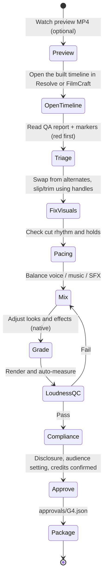

# Step 07: Human Review & Delivery

## Links
- **Hub:** [[Vcut_End_to_End_Pipeline_Architecture]] · **Decisions:** [[Vcut_Decision_Log#ADR-009 — Human gates]], [[Vcut_Decision_Log#ADR-014 — AI-content disclosure]]
- **Previous:** [[06_NLE_Adapters]] (interchange package, or an automated timeline `vNNN` + `build_report.json`), [[05_Timeline_Manifest_and_QA]] (`qa_report.json`, preview MP4)
- *This doc replaces v1's ghost link `[[Human_Review_and_Final_Export]]`: a real stage that had no doc.*

---

## Purpose
The human, as **executive editor**, reviews, fixes and approves the edit in **the one editor chosen at setup:
DaVinci Resolve (default) or FilmCraft** (**gate G4**). Every title, transition and effect is a native object
there, so nothing needs another program. Vcut then measures the final mix and produces everything needed to publish: stems, captions,
YouTube chapters, description with sources and credits, and the disclosure decision. **Vcut never auto-publishes.**

## Inputs → Outputs
| In | Out (`delivery/`) |
|---|---|
| The natively built timeline `vNNN` (or, if the build failed, the imported package), `preview/rough_cut.mp4`, `qa_report.json`, `build_report.json` (if any), ledger, `claims.json`, `script_manifest.json` | `master.mp4` (rendered **from the NLE** by the human), `stems/{voice,music,sfx}.wav`, `final_timeline.fcpxml` or `.otio` (exported from the NLE), `captions.srt` + `captions.vtt`, `chapters.txt`, `description.md`, `credits.txt`, `disclosure.json`, `titles.md`, `thumbnail_brief.md`, `upload_checklist.md`, `edit_stats.json` |

## Per-NLE notes
| | DaVinci Resolve | FilmCraft |
|---|---|---|
| Open | Resolve is left open on `vcut_<project_id>` / `…_vNNN` (Studio), or after the one-click *Workspace → Scripts → Vcut Build* (free) | FilmCraft opens on `06_editor/filmcraft/<project>_vNNN.fcproj` |
| Alternates | Bins `B-Roll/<chapter>/<slot_id>/` | Bins per slot (if `file.newBin` passes M0a), else `media/alternates/` |
| Change a title's text | Select the title → Inspector → the template's fields | Select the graphic → its template controls / Edit Text |
| Change a look or effect | Color page (the `.drx` grade) or the overlay clip's composite mode | Effect Controls (Lumetri, Noise, Vignette, Light Leaks…) |
| Ducking | The Fairlight Ducker from the template (or the baked fallback: stem on A4, original muted on A5) | Volume keyframes on the music clips (or the baked fallback) |
| Master render | Deliver page, render preset from the template | Export H.264 MP4 (or ProRes 422 HQ, then encode) |
| Hand back to Vcut | Export the edited timeline as FCPXML or OTIO to `delivery/` (automated: read back directly) | Export the edited sequence as OTIO or FCPXML to `delivery/` |

## Review workflow (G4)

- **Red markers first:** licence look-ups, UNFILLED slots, TTS QC failures. **Then yellow:** low-confidence matches, QA warnings.
- **Swapping a shot** means dragging from `B-Roll/<chapter>/<slot_id>/` (automated build, licences in clip metadata) or from the package's `media/alternates/<slot_id>/` folder (import; licences in `credits.txt` and the ledger).
- If the native build failed and the package was imported by hand, marker notes are in `markers.csv` and titles in `titles.csv`.
- Media was harvested with handles, so **slip and trim work** (v1 pre-trimmed clips to slot length, leaving nothing to slip).

## Mix & loudness QC
1. Mix in the NLE: voice / music / SFX buses and a **master limiter** (Resolve: Fairlight, from the template project; FilmCraft: its audio mixer).
2. Render, then **measure the rendered file automatically** (FFmpeg `ebur128` / `loudnorm` in measure mode):
   - integrated loudness **≈ −14 LUFS ±1 LU**. This is the widely reported YouTube playback reference, not an official YouTube spec; YouTube turns loud uploads down but does not turn quiet ones up.
   - true peak **≤ −1 dBTP**;
   - a minimum **voice-over-music margin** under narration.
3. On failure, report it and drop red markers at the offending regions, then loop back to Mix.
4. Export **stems** with the master, so a re-mix never needs a re-render of the edit.

## Delivery package
**Captions and chapters are derived from the *final* timeline, not from the manifest.** The human may have
moved things, so 07 reads the A1 unit clips and chapter markers from the **final timeline export** (FCPXML or
OTIO saved from Resolve or FilmCraft to `delivery/`; automated builds can read back directly) and re-maps the
word timings by unit offset. Units are matched by media file name (`<unit_id>.wav`). If a unit was razor-cut
inside, its captions are flagged for a manual check.

| Output | Rules |
|---|---|
| `captions.srt` / `.vtt` | From `text_display` (not the spoken form) + word timing, frame-snapped. Break lines at phrases or punctuation. ≤42 characters per line (common guideline), ≤2 lines, min/max cue duration |
| `chapters.txt` | Only `kind: chapter` markers. YouTube rules: first entry **00:00**, **≥3** ascending, each **≥10 s**. Review markers never leak in (v1 mixed "Check Transition Here" into the same list). Not produced when the video has fewer than 3 chapters |
| `description.md` | Summary, chapters, **Sources** (from `claims.json`), credits block, disclosure note if applicable |
| `credits.txt` | From the ledger: CC-BY credits required (title, author, link, licence); Pexels/Pixabay courtesy credits; premium library credits where the licence asks |
| `disclosure.json` | Computed `disclosure_required` + reasons (which assets); **human confirms** at G4 |
| `titles.md`, `thumbnail_brief.md` | 3–5 titles tied to the hook (Mode W) or the script's opening lines (Mode S); thumbnail brief agreed at G2. Hook, title and thumbnail are designed together. With AI `none`: the working title plus a blank template |
| `upload_checklist.md` | Altered/synthetic content toggle · made-for-kids setting (from the G2 checklist) · upload captions · paste chapters · attach credits · **manual publish only** |

## Compliance checklist (part of G4)
- [ ] Every red marker resolved or consciously accepted.
- [ ] `disclosure_required` reviewed. It is true for photoreal synthetic depictions of real places, events or people, synthetic scenes presented as real, or AI music as the main focus; narrating with your own cloned voice is exempt.
- [ ] The video carries the creator's own perspective and is not a templated read-out of sources (YouTube "inauthentic content", renamed 15 Jul 2025, and "reused content").
- [ ] Audience setting decided; credits complete; no asset without a ledger entry.

## Feedback loop
After G4, diff the final timeline against `vcut_timeline.json` by `clip_id` (automated builds carry it in
marker/metadata; for an imported package, clips are matched by media file name, which is the `asset_id`, plus
track and nearest record position). Record in `edit_stats.json`:
slots kept, swapped or trimmed; SFX deleted; markers resolved; polish minutes. These feed the success
metrics and tuning in [[Vcut_End_to_End_Pipeline_Architecture#10. Success metrics & feedback loop]].

## Acceptance tests
- `chapters.txt` passes YouTube's three rules; it contains no review marker.
- Measured loudness and true peak of `master.mp4` are within target, or the run reports failure.
- `credits.txt` contains an entry for every CC-BY asset placed in the final timeline.
- Captions match the final timeline after a human slips one voice unit by 10 frames, for a final timeline exported from **each** target NLE.
