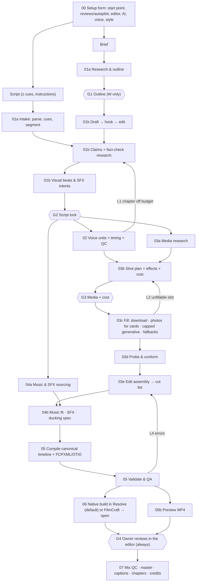

# Vcut: End-to-End AI Video Production Pipeline
## Architecture v2.3 — canonical stage graph, gates, budget and roadmap

> **Project:** Vcut
> **Status:** Architecture v2.3, **revised 2026-10-26 and 2026-10-27** to match the owner's goal ([[Vcut_Plan_Review_2026-10-26]]). v2 (2026-10-12) and v1 are archived in `_archive/`.
> **Input (any one):** a **brief**, a **script**, or a **script with cues/instructions**, plus an optional own recording ([[Vcut_Decision_Log#ADR-001 — v1 product mode]])
> **Setup:** every choice up front in one form, including **autopilot** to the editor ([[Vcut_Decision_Log#ADR-018 — Project setup options and autopilot]])
> **Output:** the timeline **built natively inside one editor: DaVinci Resolve (default) or FilmCraft**, every title and effect editable there, + a preview MP4 ([[Vcut_Decision_Log#ADR-002 — NLE targets]], [[Vcut_Decision_Log#ADR-021 — One editor: everything native and editable]], [[Vcut_Decision_Log#ADR-017 — Preview render]])
> **AI:** per role: **Antigravity (default)**, other agent apps, local Ollama, cloud, or none ([[Vcut_Decision_Log#ADR-016 — AI providers and the no-AI path]])
> **Style:** faceless documentary, with a preset effects library implemented natively in each editor ([[Vcut_Effects_Library]])
> **Source of truth:** `vcut_timeline.json`; FCPXML/OTIO are generated exports ([[Vcut_Data_Contracts]])
> **Directory:** `E:\((_atWork_))\Vcut`

---

## 1. Document map

| Doc | Role |
|---|---|
| [[AGENTS]] | Scope, principles, rules for agents working in this vault |
| [[Vcut_Decision_Log]] | **Binding decisions** (ADRs). Other docs never re-decide |
| [[Vcut_Data_Contracts]] | **The only place artifact fields are defined** |
| [[Vcut_Tool_Allowlist]] | Dated tool matrix: licence, automation rights, attribution, status |
| [[00_Brief_and_Orchestrator]] | Inputs (script, instructions, brief, channel profile), workspace, runner, CLI, caching, budget, secrets, runtime profile |
| [[01_Scriptwriting_Engine]] | **Mode S:** script intake → fact-check research → visual beats. **Mode W:** research → outline → draft → hook → edit |
| [[02_Voice_and_Timing]] | Narration units, word timing, QC, duration re-fit |
| [[03_Shot_Planning_and_Visuals]] | Candidate search, shot plan, fill (stock/graphics/generative), conform, edit assembly |
| [[04_Music_SFX_and_Ducking]] | Music beds, SFX, ducking specification |
| [[05_Timeline_Manifest_and_QA]] | Compile the canonical timeline, export FCPXML/OTIO, validate, **preview render** |
| [[06_NLE_Adapters]] | Native build in Resolve (default) or FilmCraft; backup interchange package; capability matrix |
| [[07_Human_Review_and_Delivery]] | Review in the NLE, mix/loudness QC, captions, chapters, credits, disclosure |
| [[Vcut_Effects_Library]] | Documentary effects presets: looks, overlays, motion, transitions, text with SFX, article/people/data cards |
| `pipeline.yaml` | The orchestration manifest the runner reads (still `vcut.pipeline/2`; v3 pending, see the 10-26 review) |
| `research/` | Analyses of OpenMontage and OpenChatCut (AGPL-3.0: borrow patterns, never code) |
| [[Vcut_LongForm_Pipeline_Brainstorming]] | *Archived exploration*; background for the deferred **Mode B** (recorded footage) |

---

## 2. What Vcut v1 does
The owner opens **New video**, fills one setup form (or picks a saved preset) and gives Vcut a starting point:
a brief, a script, or a script with cues such as "[visual: aerial of a substation]" or "[effect: location stamp]",
and optionally their own narration recording. Then Vcut:
1. **gets a locked script**: if the owner gave one, it is parsed and kept word for word, with no writing step; if they gave a brief, Vcut writes the script (review optional);
2. **researches** it: fact-checks every number, date, name and quote, and works out what each idea should show;
3. **researches the media**: searches stock video and photos, Wikimedia Commons, the owner's own media and library for every idea, ranks the candidates, and downloads the chosen ones **plus alternates**, filed by chapter in the video's folder;
4. **voices** it (local Qwen3-TTS, Kokoro, ElevenLabs, or the owner's recording) and times every word;
5. **styles** it with documentary presets: archival looks, light leaks and grain, moving photos, location/date stamps, quote and person cards, article highlights, each text effect with its sound;
6. **compiles** one validated timeline, **builds it natively in DaVinci Resolve (default) or FilmCraft**, where every title, transition and effect stays editable, and renders a **preview MP4**.

With **autopilot** on, all of that happens without a stop, and the owner's first stop is the finished timeline
inside the editor. With it off, the owner reviews the script and/or the media plan on the way. The owner polishes
and approves in the editor, and Vcut produces the delivery package (captions, chapters, credits, disclosure).
AI (by default Antigravity) helps at the judgement steps, and the pipeline still runs without it. The AI does the assembly; **the human owns the editorial voice**, at the gates. That, plus the
owner's own script, is what keeps the output clear of YouTube's "inauthentic content" monetisation rule ([[AGENTS#Platform constraints]]).

---

## 3. Canonical stage table
Every doc's Previous/Next links derive from this table. Artifact names come from [[Vcut_Data_Contracts#2. Artifact catalogue]]. **Mode** = S (starts from a script, with or without cues), W (starts from a brief). Every gate is *review* or *auto* per `project.yaml`; autopilot sets them all to auto.

| Stage | Mode | What | Consumes | Produces | Runs in parallel with | Gate / loop |
|---|---|---|---|---|---|---|
| **00** | S W | **Setup form**: starting point, uploads (script, instructions, recording, own media), every option | human input | `project.yaml`, `00_input/*` | — | — |
| **01a** | S | **Intake:** parse script, strip cues, segment into chapters/lines/units | script source, instructions, profile | `script/intake.json` | — | — |
| **01a** | W | Research → outline | brief, profile | `claims.json`, `outline.json` | — | **G1** outline |
| **01b** | S W | S: claim extraction + **fact-check research** + normalisation + visual beats. W: draft → hook → edit → claim audit → visual beats | intake or outline, claims, profile | `claims.json`, `script_manifest.json` | — | **G2 script lock** |
| **02** | S W | Voice: TTS units (Qwen3-TTS / Kokoro / ElevenLabs) **or the owner's recording aligned** + word timing + QC + duration check | script, profile, recordings | `voice/units/*.wav`, `timing.json` | 03a, 04a | **L1** chapter off-budget → 01b |
| **03a** | S W | **Media research**: search own media, library, stock video/photos, Wikimedia Commons per visual beat; entities for person/org cards (previews only) | `visual_beats` | `candidates.json` | 02, 04a | — |
| **04a** | S W | Music & SFX sourcing from licensed libraries (incl. SFX paired with effects) | chapter moods, profile, effects library | music/SFX shortlist | 02, 03a | — |
| **03b** | S W | Shot plan: slots from beats + timing, ranking, **effect presets per slot**, cost estimate | timing, beats, candidates, effects library | `shot_plan.json`, contact sheet | — | **G3 media + cost** |
| **03c** | S W | Fill: download chosen + alternates · photos for cards · capped generative · fallbacks (titles and effects are not rendered) | approved plan | assets + ledger entries, filed by chapter | — | **L2** unfillable → fallback chain / re-plan |
| **03d** | S W | Probe & conform media | assets | inventory, conformed media | — | — |
| **03e** | S W | Edit assembly (trims with handles, transitions) | plan, registry | `cut_list.json` | — | — |
| **04b** | S W | Music fitting · SFX placement · ducking spec | cut list, timing, shortlist | `audio_plan.json` | — | — |
| **05** | S W | Compile canonical timeline + FCPXML/OTIO exports + validate | cut list, audio plan, timing, registry | `vcut_timeline.json`, `.fcpxml`/`.otio`, `qa_report.json` | — | **L4** errors block 05b and 06 |
| **05b** | S W | **Preview render** (FFmpeg approximation; only when the editor cannot render it, i.e. free Resolve) | timeline, conformed media | `preview/rough_cut.mp4` | 06 | — |
| **06** | S W | **Into the editor:** native build in the chosen editor (Resolve default: full on Studio, one click on free; FilmCraft: full) → open it → editor-rendered preview where possible · backup package | timeline, exports, QA | `nle/package/`, `nle/<target>/build_report.json` | 05b | — |
| **07a** | S W | Review in Resolve or FilmCraft, master render, mix & loudness QC | package / timeline, QA, preview | master, stems, `loudness_report.json` | — | **G4 final approval** |
| **07b** | S W | Packaging: captions, chapters, description, credits, disclosure | final timeline export, timing, claims, ledger | `delivery/*` | — | — |

Loop **L3** (TTS QC) is internal to 02: a unit whose word-error rate is too high is re-synthesised with a respelling, then flagged.
In Mode S, **L1 never rewrites the owner's script**: it adjusts TTS speed, then reports the delta and proposed trims at a light G2 re-approval (see [[02_Voice_and_Timing#Duration re-fit (loop L1)]]).

## 4. Stage graph

*Earlier corrections still reflected here:*
- The Whisper aligner no longer runs over video and SFX files.
- B-roll is no longer "harvested" before slot lengths exist.
- SFX placement no longer depends on cut points that only appeared after the timeline was compiled (that was a cycle).
- The missing **edit-decision stage** exists (03b/03e).

---

## 5. Who decides what — AI vs deterministic code
AI makes **decisions keyed by ID**. Code does **all arithmetic, timing and serialisation**. No AI ever writes a
timecode. Every AI step has a **no-AI fallback**, so `provider: none` still yields a timeline
([[Vcut_Decision_Log#ADR-016 — AI providers and the no-AI path]]).

| AI (schema-constrained output, validated before use) | No-AI fallback | Deterministic code (always) |
|---|---|---|
| Mode S: chapter/unit segmentation proposals | `#` headings + paragraphs | Script parsing, cue stripping, line ids |
| Claim extraction (incl. paraphrase); verdicts from search results | Regex extraction; human marks claims at G2 | Fetching, de-duplicating sources; originality/overlap check |
| Mode W: chapter drafting, hook variants, whole-script edit | — (Mode W needs AI) | Text normalisation (locale tables + lexicon) |
| Visual beats: intent, search queries, negative terms | Author cues; keyword queries per sentence | Word timing extraction; WER QC; duration measurement |
| Choosing between ranked candidates **by id** | Top embedding score | Slot segmentation inside pacing bounds; frame quantisation |
| Effect presets per beat **by id** (location stamp, person card, push-in…) | Owner's `[effect:]` cues + the look's style rules | Density limits, per-editor implementation lookup, every frame and value, paired-SFX sync |
| Music mood per chapter; SFX intent | Author cue or channel default | Trims, handles, track assignment, transitions |
| Review-marker notes | Templated notes | Music fitting, SFX sync, ducking envelope, licence checks, validation, FCPXML/OTIO, preview render, NLE builds |

---

## 6. Human gates (summary)
Details: [[Vcut_Decision_Log#ADR-009 — Human gates]]. For each gate the owner chooses at setup: **Review**
(the run waits; review in the **Living Storyboard**, approve by click or `vcut approve`) or **Auto** (the runner
passes it under the owner's policy). **Autopilot** = every gate before the editor on Auto. AI agents and MCP can
read status and ask for approval, never give it or change the policy. Each gate shows the **cost and ETA of the next stage**.

| Gate | Mode | Approves | Default | Autopilot still stops if… | Blocks |
|---|---|---|---|---|---|
| **G1** Outline | W | Thesis, chapter plan, word budgets, promise map | Review | — | Drafting |
| **G2** Script lock | S W | Parsed script (S: segmentation and cues; W: final text, chosen hook), claims + verdicts + sources, proposed edits, lexicon, editorial/legal checklist | Review | a claim is `contradicted`; an unrecognised cue | All TTS, downloads and generation |
| **G3** Media + cost | S W | Slots, chosen media and alternates, effects per slot, generative slots, exact dollar cost | Auto when cost is $0 | cost > budget or spend limit; > 20% of slots unfilled | Paid downloads and generation |
| **G4** Final review | S W | The timeline **inside Resolve or FilmCraft**, preview, QA report, mix, disclosure, audience setting, credits, red rights markers | **Always the owner** | — (never automatic) | Delivery package |

---

## 7. Tool stack (summary)
The full dated matrix, with licence and automation rights, is in [[Vcut_Tool_Allowlist]]. **Price is not the sorting key; licence and automation permission are.**

| Stage | Production default | Draft / free tier | Excluded (why) |
|---|---|---|---|
| AI (per role) | **Antigravity** (installed agent app) · Claude Code · cloud API | Local Ollama model · Claude Desktop (pull) · Hermes · **none** | Llama 70B local (doesn't fit 16 GB VRAM) |
| Research | Tavily or Perplexity Search/Agent API behind one interface | Self-hosted SearXNG (JSON enabled) | "DuckDuckGo Search API" (none exists for full results) |
| Voice | Owner's recording · **Qwen3-TTS (local)** · ElevenLabs paid | Kokoro-82M (Apache-2.0) | Edge-TTS (unofficial endpoint) |
| Timing | TTS-native timestamps · forced alignment for human VO | same | faster-whisper as an aligner (QC only) |
| Stock video & photos | Own media/library first · Pexels API (primary) · Pixabay (low volume) | same | Storyblocks/Envato bots (contract or manual only) |
| Images of people, places, documents | Wikimedia Commons API (per-file licence in the ledger) · public-domain archives via `00_input` | same | Google Images / scraping image search |
| Article captures | Headless browser screenshot of a page already cited in research, with a rights decision (M2) | Re-typeset article card | Arbitrary URLs from an LLM |
| Effects & cards | **Native in the editor:** Resolve Fusion title templates, `.drx` grades, composite modes; FilmCraft `.fcgt` templates, its effects and 112 transitions · overlay clips generated once procedurally | same | Unlicensed overlay packs · a separate effects renderer in M1–M2 (EffectCraft, Remotion) |
| Archival | Manual `00_input/media/` with a rights decision | — | Automated yt-dlp / screen capture of third-party video |
| Generative video | Cloud model on a paid commercial tier, ≤10% of shots | none | Local Wan 2.2 on this 16 GB GPU (needs ≥24 GB) |
| Graphics | Python-rendered ProRes 4444 / PNG seq.; NLE title templates where supported | same | WebM alpha (Resolve can't import WebM) |
| Music | Human-curated licensed library (Epidemic/Artlist/Pixabay Music manual) | Owner's library | MusicGen (CC-BY-NC weights), Udio (no downloads), FMA "API" (unverifiable) |
| SFX | Curated local library from CC0 / owned packs | same | Freesound NC & Sampling+ |
| Preview | Rendered by the editor (FilmCraft CLI export; Resolve Studio render job); FFmpeg approximation on free Resolve | same | — |
| NLE | **Resolve** (default; Studio API, or the in-app script on free) or **FilmCraft 0.13.0** (`filmcraft-cli`); FCPXML/OTIO package as backup | Package only | pydavinci (unmaintained since 2022) |

---

## 8. Budget & quotas (per video)
Figures verified on 2026-10-12 unless marked *(est.)* or *(unverified)*. The pipeline writes actual spend to `run_report.json` and **stops before the project's `budget_usd` cap**.

| Item | Zero-cost preset (M1) | Final-hybrid preset | Notes |
|---|---|---|---|
| AI (all roles) | $0 (`none` or local Ollama) | Mode S ≈ $0.20–1 *(est.)*; Mode W ≈ $1–3 *(est.)* for 45 min | Mode S sends only extraction/tagging calls; Mode W drafts ≈0.5M in / 0.1M out tokens at Sonnet-class $2/$10 per MTok |
| Research (fact-check) | $0 (SearXNG) or human-only | search credits *(est. < $1)* | One query set per claim |
| Narration | $0 (Kokoro, local, or owner voice) | ElevenLabs ≈40–60k credits per 45 min | Multilingual v2 = 1 credit/char; plans: Starter 30k · Creator 121k · Pro 600k credits/month |
| Stock search | $0 | $0 | Pexels 200 req/h, 20k/month (raise on request); Pixabay 100 req/60 s, 24 h cache, no mass downloads |
| SFX | $0 | $0 | Local library; Freesound top-ups capped at 500 original downloads/day (OAuth2) |
| Music | owned library | subscription *(price unverified)* | Licence file stored per track in the ledger |
| Generative video | — | ≤10% of shots; ≈$0.05–0.58 per second *(unverified, aggregator figures)* | e.g. 30 shots × 5 s ≈ $8–90 before rerolls |
| NLE | $0 (Resolve free, one click; or FilmCraft, full) | Resolve Studio US$295 one-off, for full autopilot into Resolve | ADR-002 |

---

## 9. Roadmap
[[Vcut_Decision_Log#ADR-011 — Build order (MVP)]]. Each milestone must pass its acceptance criteria before the next one starts.

| Milestone | Scope | Acceptance criteria |
|---|---|---|
| **M0a Native-build spike** | 60 s hand-made fixture (fixed WAV + timing, 6 local clips, 1 still with a push-in, 1 music bed, 3 markers, 1 dissolve, 1 look, 1 light leak, 2 title templates) → built natively in **Resolve 20.0.1 free (Scripts menu) and FilmCraft 0.13.0 (CLI)** | Capability matrix in [[06_NLE_Adapters]] filled for both; all clips online; cuts at manifest frames (readback diff = 0); titles editable in the inspector; path with `((_atWork_))` survives. FilmCraft part partly done 2026-10-27 |
| **M0b Contracts** | JSON Schemas, validator, quantiser, compiler, FCPXML/OTIO writers for the ✔ fields only; FFmpeg preview of the fixture | Fixture validates; compile twice = byte-identical; preview plays with correct cuts |
| **M1 Script-in slice (3–5 min)** | Setup form → owner's script (± cues) → intake → fact-check → Qwen3-TTS, Kokoro or own recording → own media + Pexels + Wikimedia → 20 starter effect presets, native in both editors → ducking (Resolve Ducker / FilmCraft keyframes / baked stem) → native build in the chosen editor (Resolve default) + preview → G4. AI default **Antigravity**; **AI `none` must also work**; **autopilot** works end to end | 0 uncovered frames · 0 licence violations · owner's words unchanged (diff = 0 against source, cues aside) · captions + `chapters.txt` valid · loudness within ±1 LU of target · $0 third-party spend · per-video folder matches ADR-019 |
| **M2 Mid-form (10–15 min) + brief start** | **Write-from-brief**; the rest of the effects library (native), article captures; alternates; full SFX; per-line regeneration; full automation into Resolve Studio (if bought) | One-line edit after G2 re-voices only its unit and re-times the rest · ≥70% B-roll slots kept unchanged at G4 · ≤2 h human polish · readback diff = 0 |
| **M3 Long-form (45 min+)** | Generative video under caps; maps; resumable runs; opt-in pre-rendered presets for effects no editor has natively | A killed run resumes without repeating paid calls · wall-clock and cost within the budget · same M1/M2 criteria |

## 10. Success metrics & feedback loop
After G4, the human exports the final timeline from their NLE (FCPXML or OTIO; automated targets read it back
directly) and 07 diffs it against the generated manifest by `clip_id`. Per-category edit statistics are stored
per run: slots kept / swapped / trimmed, SFX deleted, markers resolved, polish minutes. These tune queries,
cadence rules and SFX density between versions. v1 targets:
- ≥70% of B-roll slots kept;
- ≤2 h polish per 10 min of output;
- 0 unlicensed assets;
- loudness pass;
- 0 factual corrections after G2;
- owner's script words unchanged unless the owner accepted an edit.

## 11. Known risks & open spikes
| Risk / spike | Where resolved |
|---|---|
| Which native routes work in each editor (Resolve: Fusion title placement and inputs, DRX grades, Dynamic Zoom, dissolves via FCPXML; FilmCraft: ducking, captions, opening the project) | M0a spike → [[06_NLE_Adapters#Capability matrix]] |
| Native presets cost one template per editor (about 20 × 2 for M1), made by hand | Build Resolve first (default editor) and FilmCraft second; the catalogue marks which editors each preset has; a missing one is simply not offered ([[Vcut_Effects_Library]]) |
| **FilmCraft is alpha** (0.13.0; README: Windows less tested than macOS); command ids and the project schema may change between releases | Pin 0.13.0; re-run the M0a probe on each upgrade; the backup package still imports |
| Installed Resolve is **20.0.1, apparently the free edition**; 21.1 removed scripting from free | IMPORT mode needs no scripting; buy Studio only for the automated build ([[Vcut_Decision_Log#ADR-002 — NLE targets]]) |
| No-AI runs give weaker visual beats and claim checks | Author cues in the script; human review at G2/G3; bind `tagging` to a local model when ready ([[Vcut_Decision_Log#ADR-016 — AI providers and the no-AI path]]) |
| An agent or scraped text tries to approve a gate | Approvals only from the owner or the owner's autopilot policy, HMAC-signed; agent workspaces confined to their task folder ([[Vcut_Decision_Log#ADR-009 — Human gates]]) |
| Full autopilot into Resolve (the default editor) needs Studio; the free edition's one-click script path is unverified and ends at 21.1 | M0a test; buy Studio, or choose FilmCraft for full autopilot today ([[Vcut_Decision_Log#ADR-002 — NLE targets]]) |
| Antigravity runs tasks in a GUI window (no verified headless mode) | Batch tasks per chapter; timeouts fall back to the no-AI path; adopt `agy` headless if verified ([[Vcut_Decision_Log#ADR-016 — AI providers and the no-AI path]]) |
| Autopilot from a brief = mass-produced look (YouTube "inauthentic content") | G4 always the owner; preset rotation; own script/recording recommended ([[Vcut_Decision_Log#ADR-018 — Project setup options and autopilot]]) |
| Article screenshots and photos of real people carry rights risk | Rights decision per item; red markers under autopilot; re-typeset card as the safer default ([[Vcut_Effects_Library]]) |
| YouTube "inauthentic content" (renamed 15 Jul 2025) and synthetic-content disclosure | Owner's own script, G2 perspective check, anti-template rules, G4 compliance ([[AGENTS#Platform constraints]]) |
| Generative video realism and cost | ≤10% cap, stylised prompts, disclosure flag ([[03_Shot_Planning_and_Visuals]]) |
| Vendor drift (model retirements, API migrations) | Dated [[Vcut_Tool_Allowlist]]; re-verify before each milestone |
