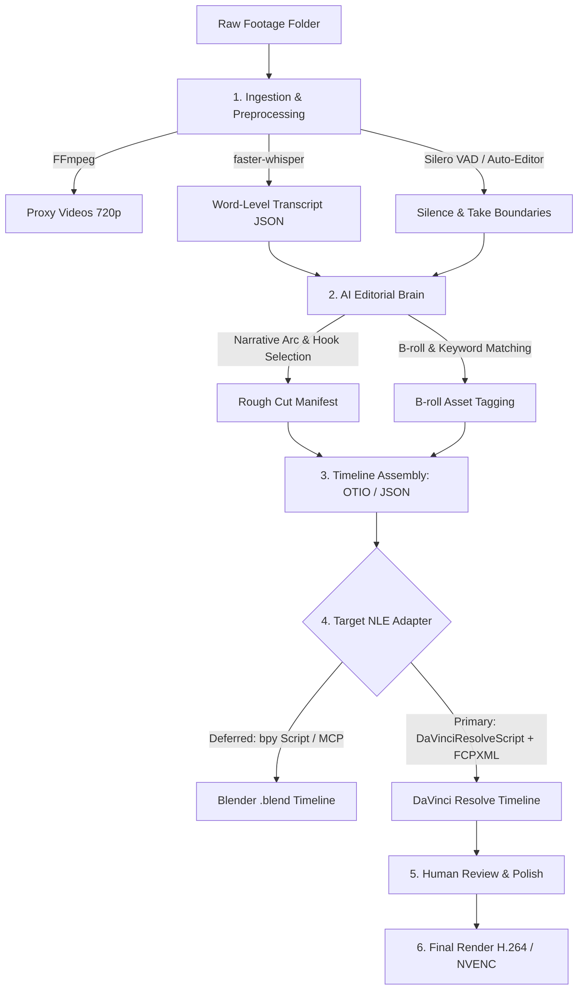

# Vcut: Long-Form Automated Video Editing Pipeline
## Architectural Brainstorming & Engine Evaluation

> **Status:** ARCHIVED EXPLORATION — superseded 2026-10-12. **Not a rules source.**
> **Target Format:** Long-Form (10–60+ minute YouTube videos, video essays, podcasts, interviews)
> **Workspace:** `E:\((_atWork_))\Vcut`

> [!warning] Read this first
> This doc explored a **raw-footage editor** with **Blender** as the primary NLE. The plan has since decided
> otherwise:
> - v1 is **script-to-video** ([[Vcut_Decision_Log#ADR-001 — v1 product mode]]);
> - the master NLE is **DaVinci Resolve Studio** ([[Vcut_Decision_Log#ADR-002 — NLE targets]]);
> - raw-footage editing is the deferred **Mode B (recorded footage)**, which will reuse every stage from Shot Planning onward.
>
> Keep this doc only as Mode B background. Factual corrections from the review are inline, marked *(corrected 2026-10-12)*.
> Current plan: [[Vcut_End_to_End_Pipeline_Architecture]] · review: [[Vcut_Plan_Review_2026-10-12]].

---

## Pipeline Step Map (Graph Nodes)
- **Master Blueprint:** [[Vcut_End_to_End_Pipeline_Architecture]]
- **Steps:** [[00_Brief_and_Orchestrator]] · [[01_Scriptwriting_Engine]] · [[02_Voice_and_Timing]] · [[03_Shot_Planning_and_Visuals]] · [[04_Music_SFX_and_Ducking]] · [[05_Timeline_Manifest_and_QA]] · [[06_NLE_Adapters]] · [[07_Human_Review_and_Delivery]]
- **Agent Rules:** [[AGENTS]] · **Decisions:** [[Vcut_Decision_Log]]

### Mode B gaps this doc did not solve (for when Mode B is scheduled)
- **Diarisation:** WhisperX + pyannote (needs a Hugging Face token and agreement acceptance; "far from perfect" with overlapping speech), with human confirmation of speaker labels.
- **False starts / retakes:** verbatim-oriented ASR (e.g. CrisperWhisper) plus audio cues. LLM take selection as *suggestions*, never auto-deletions.
- **Cut rules:** pad each cut 80–150 ms, cut at zero crossings with micro-crossfades, fill with room tone, cover jump cuts with a punch-in or B-roll. The 0.8 s pause threshold is a per-genre tunable.
- **Multi-speaker:** per-speaker tracks, bleed reduction, per-speaker levelling, waveform multicam sync.
- **Consent:** a per-speaker release before processing. Never splice a speaker's words into statements they did not make.

---

## 1. The Reality of Long-Form Video Editing

Editing long-form video (20 to 60+ minutes) introduces constraints fundamentally different from short-form (TikTok/Reels):

| Dimension | Short-Form (30–90 sec) | Long-Form (15–60+ min) |
| :--- | :--- | :--- |
| **Footage Volume** | 1–5 clips, a few minutes total | 2 to 10+ hours of raw footage |
| **Rendering Bottleneck**| Negligible (1,000–3,000 frames) | Severe (50,000–150,000+ frames) |
| **Memory / RAM** | Easily fits in browser/headless memory | Browser-based engines (Remotion) risk OOM crashes |
| **Proxy Workflow** | Unnecessary | Essential (editing with 720p/1080p proxies instead of 4K raw) |
| **Human Review** | Simple (watch through in 60s) | Non-negotiable (editor must scrub, slip cuts, check pacing) |
| **Audio Complexity** | 1 voiceover + 1 background track | Multi-speaker diarization, room noise reduction, continuous ducking |

---

## 2. Engine Evaluation for Long-Form

### A. Blender (VSE) — Strong Candidate for Open / Local Workflow
* **Why it fits Long-Form:**
  - **Native Proxy Support:** Built-in proxy generation (25%, 50%, 75%, 100% *(corrected 2026-10-12)*) allows snappy timeline scrubbing even with hours of 4K footage.
  - **No Memory Explosion:** Streams video strips from disk rather than buffering entire frame trees in DOM memory.
  - **Local & Open Source:** Zero licensing fees, runs completely offline on Windows (`bpy`), and has native headless CLI (`blender -b -P script.py`).
  - **Direct Agent Connection:** Can be manipulated live via the Blender MCP server (`execute_blender_code`) or standalone Python scripts.
  - **Human-in-the-Loop:** Produces an ordinary `.blend` file. You can open Blender, see the entire timeline, trim cuts with standard hotkeys, adjust audio strips, and render when ready.
* **Limitations to Solve:**
  - Primitive native text strips: Kinetic titles or lower-thirds should be pre-rendered as transparent video or rendered via Blender's 3D/Compositor workspace rather than basic VSE text strips.
  - Audio ducking: Must be scripted in Python (keyframing volume on speech timestamps) or handled via an FFmpeg audio post-process.

### B. DaVinci Resolve — The Professional Benchmark
* **Why it fits Long-Form:**
  - The undisputed industry leader for multi-track editing, color grading, and Fairlight audio mastering.
  - Smooth playback of multi-hour timelines, given an edit-friendly codec or proxies and a supported GPU (H.264/H.265 GPU decode and extra profiles are Studio-only per the codec list). *(corrected 2026-10-12; was "zero lag")*
  - The official Python API (`DaVinciResolveScript`) can place clips at exact frames on chosen tracks, add markers, create bins and configure render jobs. It **cannot** set volume keyframes, ducking or animated transforms; transitions and fades are scriptable only on Studio 21.1+. `pydavinci` is unmaintained (last release May 2022). *(corrected 2026-10-12)*
* **Limitations:**
  - Scripting requires **DaVinci Resolve Studio** ($295). Since 21.1 the free edition has no Python scripting at all.
  - Headless *is* possible: the README documents `-nogui`, with scripting still working. The real constraints are Studio-only scripting and a running Resolve process. *(corrected 2026-10-12)*

### C. Remotion — Best as a "Micro-Asset" Generator (Not Primary Long-Form NLE)
* **Verdict for Long-Form:**
  - **Not recommended as the master timeline engine for 45-minute videos.** Render time scales with frame count (~100,000 frames), and there is no interactive NLE timeline for review. *(corrected 2026-10-12: Remotion uses a bounded frame cache; memory is not the main issue)*
  - **Ideal Role:** Use Remotion as an auxiliary generator for animated titles, callouts, charts or chapter cards, rendered to **ProRes 4444 `.mov`** (Resolve does not import WebM, and VP9 alpha is unsupported) and placed onto the Resolve timeline. Remotion is source-available: free for individuals and companies of ≤3 people, otherwise a paid Company License. *(corrected 2026-10-12)*

### D. OpenTimelineIO (OTIO) — The Universal Middle Ground
* **Why OTIO is a Game Changer for Vcut:**
  - OTIO is Pixar's open standard for timeline data (tracks, clips, transitions, markers, in/out points).
  - Instead of tightly coupling your AI agent to Blender's internal API, the agent generates an `.otio` timeline manifest.
  - ~~That `.otio` timeline can be loaded directly into Blender VSE, DaVinci Resolve, Premiere Pro, or Final Cut Pro.~~ *(corrected 2026-10-12)*
    - **Resolve** imports OTIO natively (18.5+; markers 18.6.5+).
    - **Premiere Pro** imports OTIO in recent versions (minimum version unconfirmed).
    - **Final Cut Pro** needs conversion to FCPXML.
    - **Blender VSE** has no native OTIO import (third-party add-ons only).
    - OTIO has **no standard schema for volume, ducking or animated transforms**, so those don't travel through it.
  - **Advantage (still true, with limits):** cuts, tracks and markers are portable. Effects need per-NLE carriers. In the current plan OTIO is an *export*, not the source of truth ([[Vcut_Decision_Log#ADR-003 — Canonical timeline artifact]]).

---

## 3. Proposed Vcut Long-Form Architecture

---

## 4. Step-by-Step Pipeline Breakdown

### Phase 1: Ingestion & Perception
1. **Proxy Generator:** Automatically encode incoming 4K footage into lightweight 720p ProRes/H.264 proxies for rapid scrubbing.
2. **Speech-to-Text (`faster-whisper`):** Extract transcripts with approximate word timestamps and pauses. *(corrected 2026-10-12: faster-whisper does **not** identify speakers; diarisation needs WhisperX + pyannote or similar. Its word times are heuristic, so use forced alignment where frame accuracy matters.)*
3. **Silence & Mistake Removal:**
   - Detect non-speech pauses (>0.8s) via Silero VAD or `auto-editor`.
   - Identify false starts (e.g., repeated phrases where the speaker corrected themselves).

### Phase 2: AI Editorial Planner (The Agent)
1. **Chunked Context Analysis:** Because a 1-hour transcript exceeds simple prompt limits, split the transcript into logical topic segments.
2. **Story Arc Structuring:**
   - Detect the "Hook" (most compelling statement or preview).
   - Outline chapters and insert chapter markers with descriptive titles.
   - Flag moments where A-roll needs visual support (B-roll, diagrams, illustrations).
3. **Timeline Generation:** Output a clean edit decision list (EDL or `.otio`).

### Phase 3: Assembly (Blender VSE Engine)
1. Open or spawn a Blender session using `bpy` (or via Blender MCP).
2. Create video and audio channels:
   - Channel 1: A-roll Audio (Voice).
   - Channel 2: A-roll Video (Camera).
   - Channel 3: B-roll Video / Overlays.
   - Channel 4: Lower-thirds / Titles.
   - Channel 5: Background Music (with automated volume dips during speech).
3. Save project as `vcut_project.blend`.

### Phase 4: Human Inspection & Polish
1. Open `vcut_project.blend` in Blender.
2. The user sees all cuts and markers on the timeline.
3. Tweak any cut, slide transitions, swap a piece of B-roll, or approve the cut.
4. Render directly from Blender or run headless batch export.

---

## 5. Next Brainstorming Milestones

> *(superseded 2026-10-12)* These milestones targeted the deferred raw-footage mode and the non-primary NLE.
> The current build order is M0–M3 in [[Vcut_End_to_End_Pipeline_Architecture#9. Roadmap]].

1. **Test Ingestion Script:** Write a Python script to take a sample long video, extract word-level Whisper transcripts, and detect silences.
2. **Test Timeline Builder:** Write a minimal Python script using `bpy` that imports clips into Blender's VSE at specified timestamps and saves the `.blend` file.
3. **Evaluate Audio Ducking:** Test programmatic volume keyframing in Blender VSE versus an FFmpeg post-processing filter.
